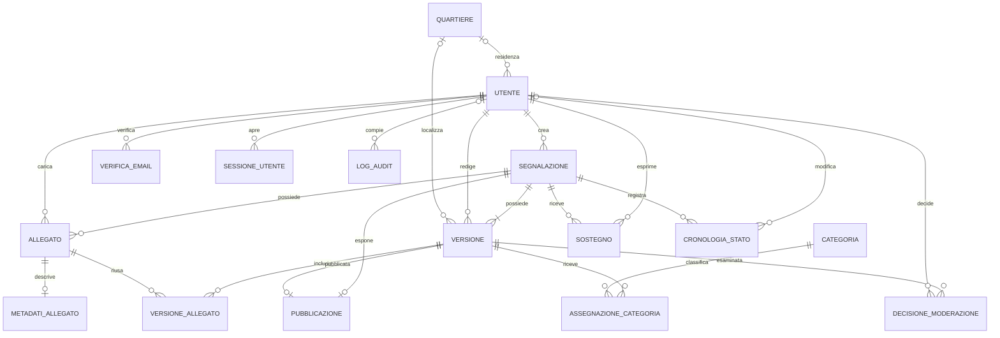

# Modello dati e architettura

## Entità

- `UTENTE`: dati anagrafici, email univoca, hash password, ruolo, stato, date e
  quartiere di residenza facoltativo.
- `QUARTIERE`: nome e codice univoci.
- `SEGNALAZIONE`: autore, stato operativo e date. L'autore è conservato anche
  quando l'account viene disattivato.
- `VERSIONE`: contenuto, coordinate dichiarate, origine posizione, quartiere,
  stato moderazione e motivo modifica. Il numero versione è univoco per
  segnalazione.
- `ALLEGATO`: proprietario segnalazione e caricatore, tipo e MIME, riferimento
  privato allo storage, dimensione, durata, checksum e stato file.
- `METADATI_ALLEGATO`: al massimo un record per allegato; coordinate estratte e
  data dichiarata rimangono separate dalla posizione della versione.
- `CATEGORIA`: catalogo attivabile/disattivabile.
- `PUBBLICAZIONE`: al massimo una riga per segnalazione, con versione e data.
- `VERIFICA_EMAIL` e `SESSIONE_UTENTE`: conservano hash dei token, scadenza e
  uso/revoca, mai il token in chiaro.
- `LOG_AUDIT`: attore, azione, entità, dettagli non segreti e data.
- `CRONOLOGIA_STATO`: transizioni operative con responsabile e motivazione.
- `DECISIONE_MODERAZIONE`: versione esaminata, admin, esito, motivazione e data.

## Diagramma ER

## Relazioni associative

- `VERSIONE_ALLEGATO` collega versioni e allegati, conserva l'ordine e usa una
  chiave esterna composta per impedire collegamenti tra segnalazioni diverse.
- `ASSEGNAZIONE_CATEGORIA` registra categoria, origine (`UTENTE`, `IA`,
  `ADMIN`), indicazione e confidenza. I valori ammessi distinguono selezione
  utente, suggerimento IA e conferma/esclusione admin; nessun modulo IA è
  implementato in questa fase.
- `SOSTEGNO` ha PK composta utente/segnalazione, stato attivo e date; consente
  ritiro e riattivazione conservando la riga univoca.

## Vincoli applicativi

La PK di `SEGNALAZIONE` non può imporre da sola almeno una versione; la prima
versione deve essere creata atomicamente con la segnalazione. Analogamente i
vincoli FK garantiscono che la pubblicazione esponga una versione della stessa
segnalazione, mentre il backend deve consentire la pubblicazione solo se la
versione è approvata e corrente. La PK di `SOSTEGNO` protegge dall'inserimento
concorrente duplicato; l'operazione applicativa deve gestire il conflitto
transazionale.

## Stati e transizioni previste

Lo stato operativo della segnalazione è indipendente dalla moderazione della
versione. Il flusso ordinario previsto è `BOZZA` -> `RICEVUTA` all'invio valido
dell'autore verificato; dopo l'approvazione admin della versione corrente,
`RICEVUTA` -> `PUBBLICATA`. La presa in carico del comitato porta a
`IN_CARICO_COMITATO`; archiviazione e ritiro registrano attore e motivazione in
`CRONOLOGIA_STATO`. Selezione e invio ai candidati restano valori riservati nel
modello, ma le relative funzioni e registrazioni dedicate sono fuori da questa
fase.

Una versione inviata parte da `IN_ATTESA_CONTROLLO`; l'esame admin la porta in
revisione e produce una `DECISIONE_MODERAZIONE` sulla versione esaminata, con
esito e motivazione. L'approvazione abilita la pubblicazione solo se la versione
è ancora corrente. Rifiuto e attesa chiarimenti restano non pubblici; una
correzione genera una nuova versione. I controlli di autorizzazione e transizione
sono applicati dal backend; un admin non può moderare una propria segnalazione.

I file non sono contenuti nel database. `riferimento_storage` punta a storage
privato sostituibile; il percorso locale di sviluppo non è una strategia di
conservazione definitiva.

## Migrazioni e database

Il target applicativo è MySQL Aiven via MySQL Connector/Python. TLS richiede CA,
verifica certificato e verifica hostname (`VERIFY_IDENTITY`). La connessione e
la presenza dello schema sono state verificate; le tabelle applicative sono
vuote. La migrazione iniziale crea solo lo schema e non viene eseguita
automaticamente all'avvio. Prima di applicarla occorre controllare versione
server, tabelle e dati presenti; non sono previste procedure ordinarie con
`DROP TABLE`.

## Architettura

L'applicazione è un monolite Flask con application factory, template Jinja e
SQLAlchemy per il modello relazionale. Flask-Migrate gestisce revisioni Alembic;
il driver MySQL Connector/Python usa TLS con CA, verifica del certificato e
dell'hostname. La configurazione arriva da variabili d'ambiente o Codespaces
Secrets. Foto e video sono salvati fuori da MySQL e serviti da route che
controllano la pubblicazione; lo storage attuale è locale e va reso persistente
o sostituito con uno storage condiviso in produzione.